# 🌍 TripCraft — Enterprise Travel Itinerary Planner Backend API

<div align="center">

[](https://nodejs.org/)
[](https://expressjs.com/)
[](https://mongoosejs.com/)
[](https://jwt.io/)
[](http://localhost:8000/api-docs)
[](https://www.postman.com/)
[](LICENSE)

<br/>

**Case Study Report NO 96: TripCraft Travel Itinerary Planner REST API**  
*School of Future Tech — B.Tech Computer Science Engineering*  
**Author:** Kunal Lubhana | **PRN / Roll No:** 150096725022

</div>

---

## 📖 Overview

**TripCraft** is a production-ready, enterprise-grade RESTful backend engineered with **Node.js**, **Express.js (v5)**, and **MongoDB Mongoose (v9)**. It provides end-to-end capabilities for modern travelers to organize day-by-day itineraries, schedule activities, upload media, collaborate across granular permission roles (`owner`, `editor`, `viewer`), track real-time budgets and categorical expenses, and retrieve live 7-day meteorological forecasts via free Open-Meteo REST endpoints.

All 19 API endpoints are fully validated using `express-validator`, secured with `helmet` and stateless HMAC-SHA256 JWT lifecycle handling, and verified via an automated **Postman Collection (v2.1)** and an interactive **Swagger (OpenAPI 3.0)** interface.

---

## 🏛️ System Architecture & Visual Diagrams

### 1. Layered Architectural Request Processing Pipeline
When an HTTP request enters the TripCraft backend on Port 8000, it traverses a deterministic sequence of security middleware, JWT validation, modular routing, and Mongoose persistence:

<div align="center">
  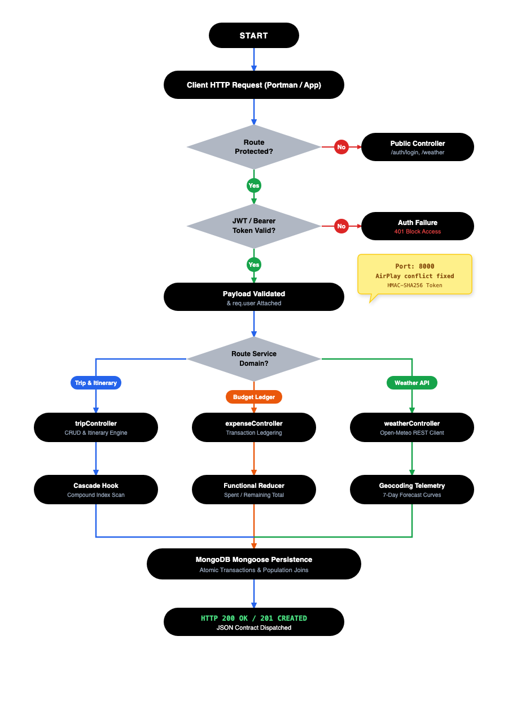
</div>

### 2. Full-Stack Domain Mind Map
Taxonomic decomposition of TripCraft backend services across six core dimensions:

<div align="center">
  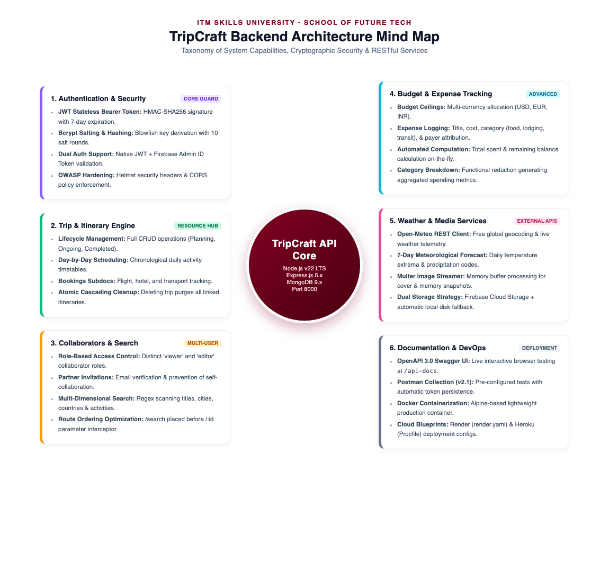
</div>

### 3. Request Lifecycle & Security Verification Flowchart
Step-by-step cryptographic validation, controller dispatch, and transaction commit flow:

<div align="center">
  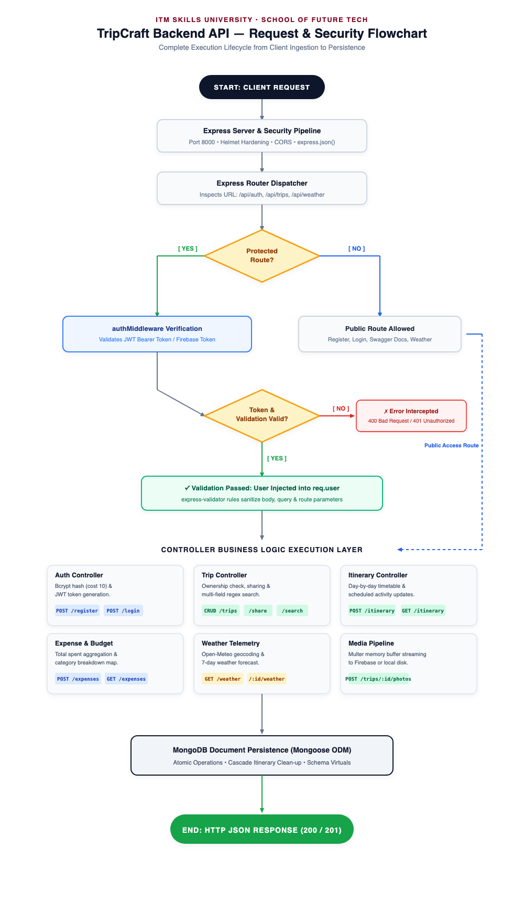
</div>

---

## ✨ Key Features & Capabilities

- 🔐 **Stateless Cryptographic Authentication**:
  - Secure registration and login using **bcrypt** adaptive salt rounds (Blowfish cipher).
  - HMAC-SHA256 Signed JSON Web Tokens (`jwt.sign`) with 7-day expiration.
  - Granular `authMiddleware` extracting Bearer tokens with strict 401 unauthorized rejection.
- 🗺️ **Full Trip Lifecycle Management**:
  - Complete CRUD for trips: Title, description, destination coordinates, start/end dates.
  - Multi-trip retrieval with sorting, filtering, and deep Mongoose `.populate()`.
  - Cascading deletion: Deleting a trip automatically purges all child itineraries from MongoDB.
- 📅 **Day-by-Day Itinerary Engine**:
  - Detailed daily scheduling with activity start times, locations, and costs.
  - Compound indexing on `{ trip: 1, dayNumber: 1 }` ensuring $O(1)$ query retrieval and zero day duplicates.
- 👥 **Group Collaboration & Access Control**:
  - Share trips via email invitations with distinct authorization roles: `viewer` (read-only) vs `editor` (itinerary & expense write access).
- 💰 **Automated Budget & Expense Ledger**:
  - Real-time financial ledger tracking categorical expenses (`Flight`, `Accommodation`, `Food`, `Transport`, etc.).
  - Atomic JavaScript functional reducers calculating `totalBudget`, `totalSpent`, and `remainingBudget`.
- 🌤️ **Live Weather Telemetry**:
  - Integration with free **Open-Meteo REST API** requiring no private subscription keys.
  - Auto-geocoding of city names into coordinates with 7-day daily maximum/minimum temperatures and precipitation sums.
- 🔍 **Multi-Dimensional Keyword Search**:
  - Regex-optimized query matching across trip titles, descriptions, destinations, and activity titles.
- 🛡️ **Production Hardening & Port Collision Fix**:
  - Pre-configured on **Port 8000** to eliminate macOS Sonoma/Ventura AirPlay Receiver conflicts on Port 5000.
  - HTTP Header hardening via `helmet`, asynchronous request logging via `morgan`, and universal `cors`.

---

## 📂 Project Directory Structure

```
backend/
├── src/
│   ├── config/
│   │   ├── db.js                     # MongoDB connection via Mongoose with auto-reconnect
│   │   └── firebase.js               # Firebase Admin & Storage initialization
│   ├── models/
│   │   ├── User.js                   # User schema with bcrypt pre-save hash hook
│   │   ├── Trip.js                   # Trip schema (collaborators, budget, expenses, cover)
│   │   ├── Itinerary.js              # Day-by-day itinerary & activities schema (compound index)
│   │   └── Destination.js            # Destination catalog schema
│   ├── middleware/
│   │   ├── authMiddleware.js         # JWT & Bearer token verification
│   │   ├── uploadMiddleware.js       # Multer memory buffer streaming handler
│   │   ├── validationMiddleware.js   # express-validator request sanitizers
│   │   └── errorHandler.js           # Centralized JSON error dispatcher
│   ├── services/
│   │   ├── firebaseStorageService.js # Firebase Storage uploader with local disk fallback
│   │   └── weatherService.js         # Geocoding & Open-Meteo weather forecast service
│   ├── controllers/
│   │   ├── authController.js         # Register, Login, Current Profile (/me)
│   │   ├── tripController.js         # Trip CRUD, search, photo uploads, collaboration
│   │   ├── itineraryController.js    # Day itinerary & activity actions
│   │   ├── expenseController.js      # Trip budget & expense tracking ledger
│   │   ├── destinationController.js  # Destinations catalog & weather query
│   │   └── weatherController.js      # Public & trip-specific weather endpoints
│   ├── routes/
│   │   ├── authRoutes.js             # /api/auth
│   │   ├── tripRoutes.js             # /api/trips (CRUD, itinerary, share, search, expenses)
│   │   ├── destinationRoutes.js      # /api/destinations
│   │   ├── weatherRoutes.js          # /api/weather
│   │   └── index.js                  # Master route aggregator
│   ├── docs/
│   │   └── swagger.json              # OpenAPI 3.0 specification
│   ├── app.js                        # Express app setup, CORS, Helmet, routes mount
│   └── server.js                     # Entry point & HTTP server listening on Port 8000
├── postman/
│   └── TripCraft_API.postman_collection.json # Exported Postman Collection (v2.1)
├── screenshot/                       # Verified test execution screenshots & diagrams
├── Dockerfile                        # Multi-stage production Docker container
├── render.yaml                       # Cloud deployment blueprint
├── Procfile                          # Heroku deployment configuration
├── .env.example                      # Sample environment variables
├── package.json                      # Dependencies and npm scripts
└── README.md                         # Comprehensive documentation
```

---

## 🚀 Quickstart & Setup Guide

### 1. Prerequisites
Ensure you have the following installed on your machine:
- [Node.js](https://nodejs.org/) (v18.x or v20.x recommended)
- [MongoDB](https://www.mongodb.com/) (Local Community Server running on `127.0.0.1:27017` or a MongoDB Atlas URI)
- [Git](https://git-scm.com/)

### 2. Clone the Repository
```bash
git clone https://github.com/<your-username>/tripcraft-backend.git
cd tripcraft-backend
```

### 3. Install Dependencies
```bash
npm install
```

### 4. Configure Environment Variables
Create a `.env` file in the root directory:
```bash
cp .env.example .env
```

Update `.env` with your settings:
```env
# Server Port (8000 avoids macOS AirPlay collision on 5000)
PORT=8000
NODE_ENV=development

# MongoDB Connection String
MONGO_URI=mongodb://127.0.0.1:27017/tripcraft

# JWT Authentication
JWT_SECRET=tripcraft_jwt_secret_key_secure_2026_token
JWT_EXPIRES_IN=7d

# Firebase Storage (Optional - Local disk uploads fallback automatically)
FIREBASE_STORAGE_BUCKET=
```

### 5. Start the Server
- **Development Mode (with Nodemon hot-reload):**
  ```bash
  npm run dev
  ```
- **Production Mode:**
  ```bash
  npm start
  ```

Upon successful startup, terminal outputs:
```
==================================================
  TripCraft API Server Started Successfully!
  Local URL:        http://localhost:8000
  Swagger Docs:     http://localhost:8000/api-docs
  Environment:      development
  Database:         MongoDB Connected (127.0.0.1)
==================================================
```

---

## 📡 Complete REST API Reference

### 1. Authentication Endpoints (`/api/auth`)
| Method | Endpoint | Access | Description |
|---|---|---|---|
| `POST` | `/api/auth/register` | Public | Register new user account (`name`, `email`, `password`) |
| `POST` | `/api/auth/login` | Public | Authenticate credentials and receive HMAC-SHA256 JWT |
| `GET` | `/api/auth/me` | Bearer Token | Retrieve currently authenticated user profile |

### 2. Trip Management Endpoints (`/api/trips`)
| Method | Endpoint | Access | Description |
|---|---|---|---|
| `POST` | `/api/trips` | Bearer Token | Create new trip with destination, dates, and budget |
| `GET` | `/api/trips` | Bearer Token | Retrieve all trips for user (owned + collaborated) |
| `GET` | `/api/trips/:id` | Bearer Token | Fetch single trip with populated itineraries and members |
| `PUT` | `/api/trips/:id` | Owner / Editor | Update trip metadata, destination, or status |
| `DELETE` | `/api/trips/:id` | Owner | Cascade delete trip and all child itineraries |
| `POST` | `/api/trips/:id/photos` | Owner / Editor | Stream photo upload to storage via Multer |

### 3. Collaboration & Search
| Method | Endpoint | Access | Description |
|---|---|---|---|
| `POST` | `/api/trips/:id/share` | Owner / Editor | Add collaborator by email (`role: viewer / editor`) |
| `GET` | `/api/trips/search?keyword=paris` | Bearer Token | Multi-field regex query across trips and itineraries |

### 4. Day-by-Day Itineraries (`/api/trips/:id/itinerary`)
| Method | Endpoint | Access | Description |
|---|---|---|---|
| `POST` | `/api/trips/:id/itinerary` | Owner / Editor | Create/append a day schedule with activity array |
| `GET` | `/api/trips/:id/itinerary` | Bearer Token | Fetch day-by-day plans sorted by `dayNumber` ascending |
| `PUT` | `/api/trips/:id/itinerary/:itineraryId` | Owner / Editor | Modify scheduled activities, times, and costs |
| `DELETE` | `/api/trips/:id/itinerary/:itineraryId` | Owner / Editor | Remove specific itinerary day |

### 5. Budget & Expense Ledger (`/api/trips/:id/expenses`)
| Method | Endpoint | Access | Description |
|---|---|---|---|
| `POST` | `/api/trips/:id/expenses` | Owner / Editor | Record expense (`title`, `amount`, `category`, `currency`) |
| `GET` | `/api/trips/:id/expenses` | Bearer Token | Compute budget telemetry, spend by category, and balance |
| `DELETE` | `/api/trips/:id/expenses/:expenseId` | Owner / Editor | Remove expense item and recalculate totals |

### 6. Meteorological Weather Telemetry (`/api/weather`)
| Method | Endpoint | Access | Description |
|---|---|---|---|
| `GET` | `/api/weather?city=Tokyo` | Public | Live geocoding + 7-day weather forecast via Open-Meteo |
| `GET` | `/api/trips/:id/weather` | Bearer Token | Fetch live weather for destination saved in trip |

---

## 📮 Automated Postman Testing

A complete, pre-configured Postman collection is included in [`postman/TripCraft_API.postman_collection.json`](postman/TripCraft_API.postman_collection.json).

### How to Import & Run:
1. Open **Postman** and click **Import**.
2. Drag and drop `postman/TripCraft_API.postman_collection.json`.
3. Set Collection Variable `baseUrl` = `http://localhost:8000`.
4. Run the **`01. Register User`** or **`02. Login User`** request.
   - *The Postman test script automatically captures the returned JWT token and sets `{{token}}` for all subsequent authenticated requests!*

<div align="center">
  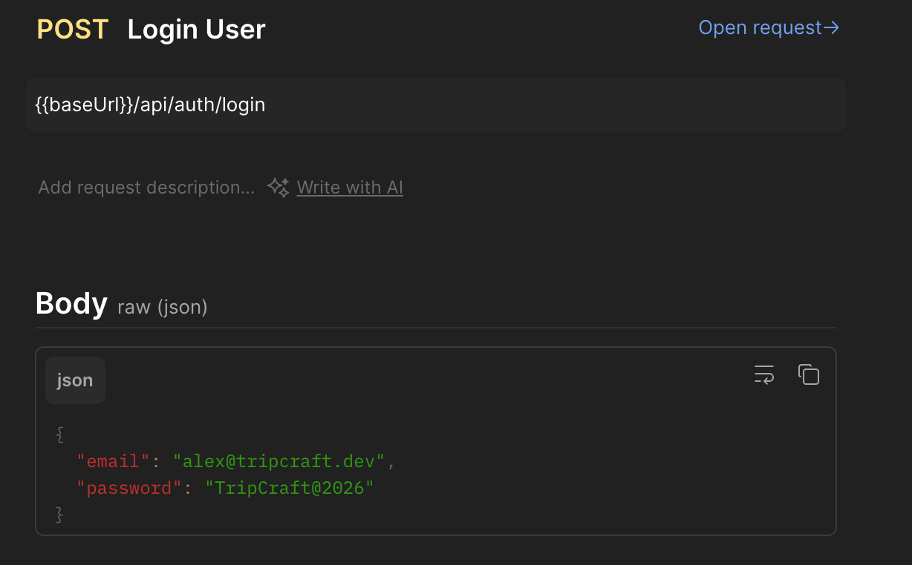
  <p><em>Postman Execution: JWT Authentication & Automatic Token Extraction</em></p>
</div>

---

## 📸 Verified Postman Test Snapshots

| Feature | Postman Test Snapshot |
|---|---|
| **User Registration** | 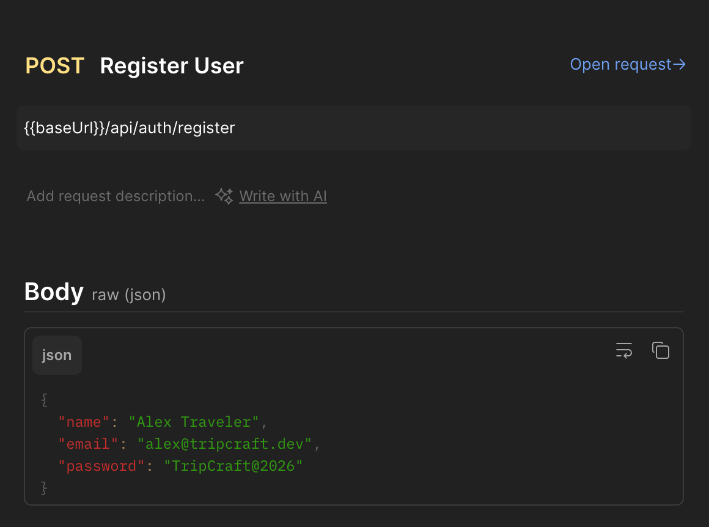 |
| **User Profile Verification** | 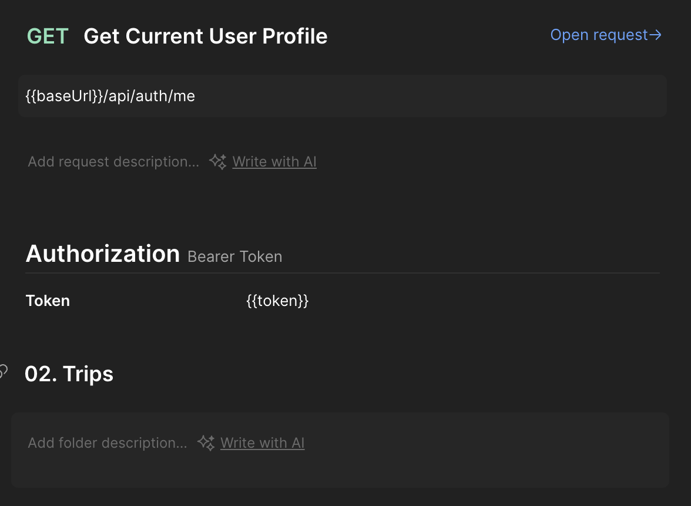 |
| **Create New Trip** | 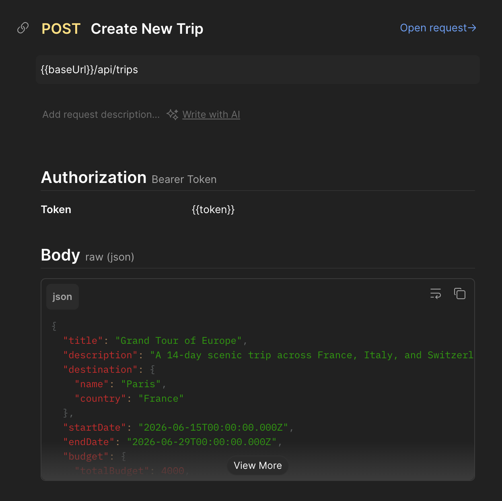 |
| **Retrieve Trips** | 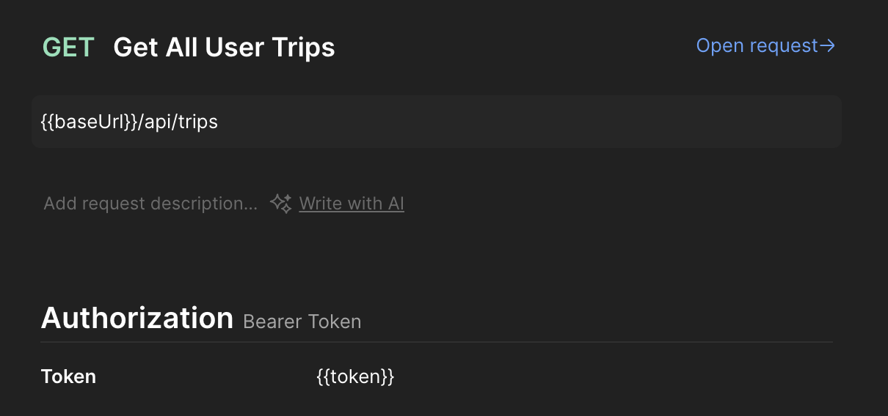 |
| **Add Itinerary & Activities** |  |
| **Group Collaboration** | 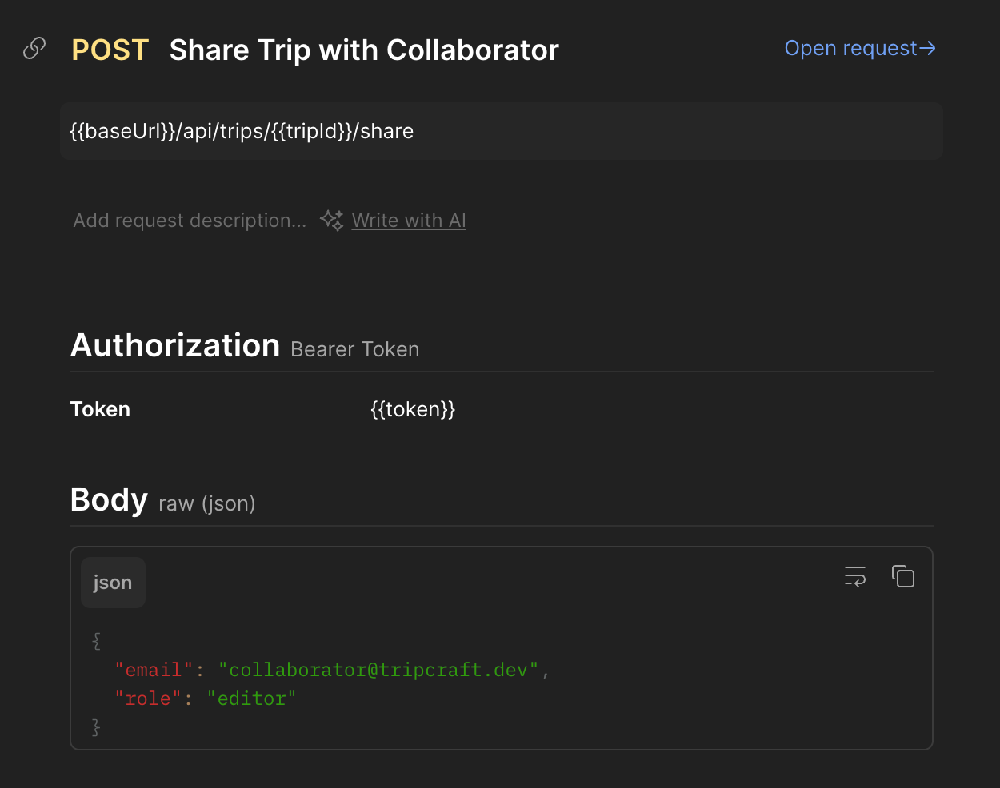 |
| **Multi-field Search** | 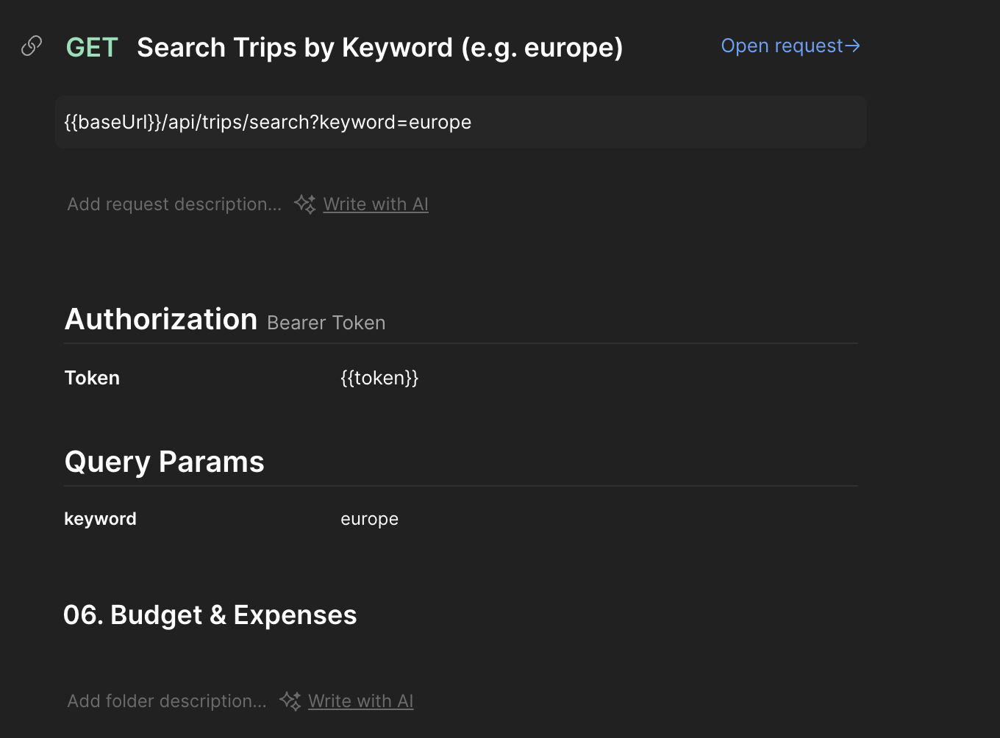 |
| **Expense Logging & Budget** |  |
| **7-Day Weather Forecast** |  |
| **Cascade Trip Deletion** | 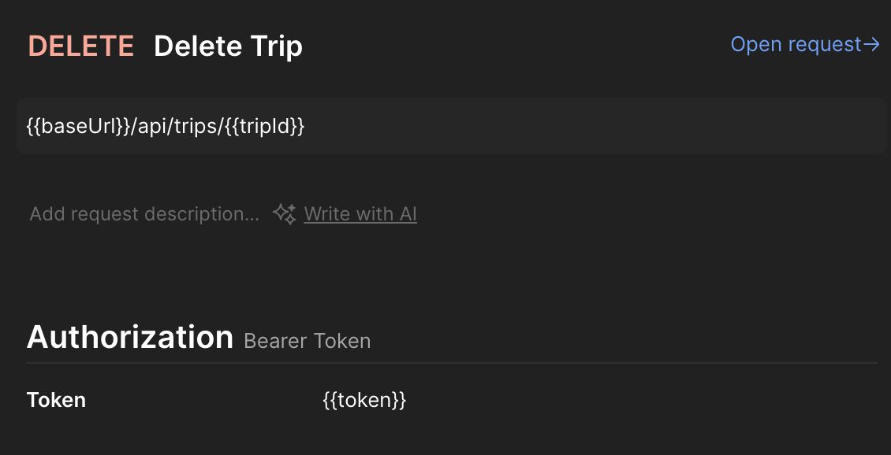 |

---

## 🐳 Docker Deployment

To build and execute TripCraft inside an isolated Docker container:

```bash
# 1. Build the production image
docker build -t tripcraft-backend .

# 2. Run the container on Port 8000
docker run -d \
  --name tripcraft-api \
  -p 8000:8000 \
  -e MONGO_URI="mongodb+srv://<user>:<password>@cluster.mongodb.net/tripcraft" \
  -e JWT_SECRET="your_production_secret_key" \
  -e NODE_ENV="production" \
  tripcraft-backend

# 3. Check container logs
docker logs -f tripcraft-api
```

---

## 🔧 Troubleshooting & Known Gotchas

### macOS Port 5000 Collision (AirPlay Receiver)
- **Problem**: On macOS Monterey, Ventura, and Sonoma, Apple's `ControlCenter` daemon automatically occupies port `5000` for AirPlay Receiver, causing `EADDRINUSE: address already in use :::5000` or returning unexpected 403 errors.
- **Solution**: TripCraft is configured by default on **Port 8000** in `.env` and `src/server.js`, guaranteeing reliable execution across macOS, Linux, and Windows environments.

---

## 👨‍💻 Author & Academic Attribution

- **Developer:** Kunal Lubhana
- **Institution:** ITM Skills University — School of Future Tech
- **Degree:** B.Tech Computer Science Engineering
- **PRN / Roll No:** `150096725022`
- **Case Study:** NO 96 — Travel Itinerary Planner ("TripCraft")
- **Academic Reference:** Notes PDF provided by faculty member

---

## 📄 License
This project is licensed under the [ISC License](LICENSE) for academic evaluation, software engineering coursework, and educational research.
